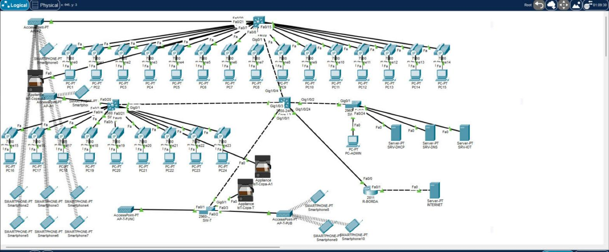
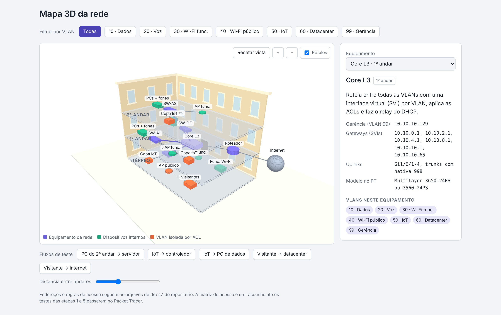
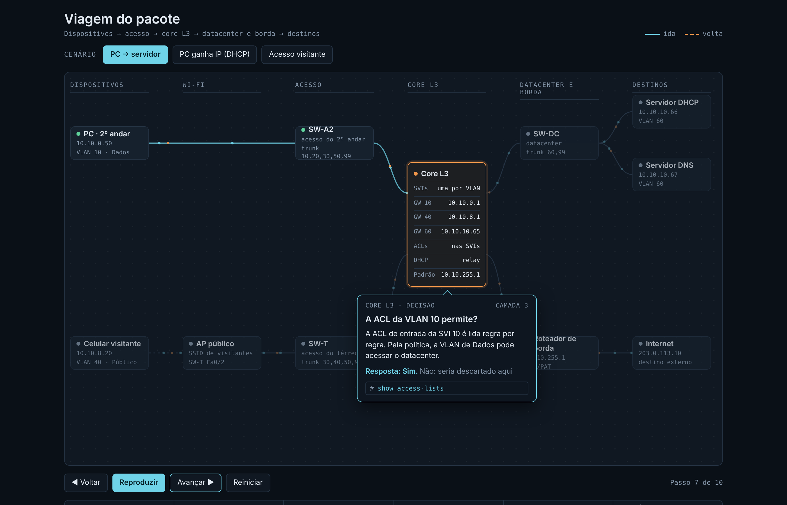

# Simulação de rede corporativa no Packet Tracer

Projeto de **Redes de Computadores I** (CEFET/RJ): projetar e simular, no Cisco Packet Tracer, a rede de uma empresa com **300 funcionários** instalada em um **prédio histórico tombado de 3 andares** (térreo, 1º e 2º andar).

O prédio é o que torna o problema interessante. Por ser tombado, o térreo não aceita piso elevado nem bandejamento, e ainda abriga um espaço de exposição aberto ao público. Isso obriga o projeto a resolver, ao mesmo tempo, três coisas que normalmente não convivem: **60 postos de trabalho sem cabo**, **visitantes na mesma planta** e **nenhum deles com acesso ao resto da empresa**.

- **Regra do enunciado:** simular apenas 10% dos dispositivos (cerca de 30), **mantendo a rede dimensionada para os 300**

## O que o enunciado pede e como foi resolvido

| Requisito | Solução |
|---|---|
| Ethernet e VoIP para os andares 1 e 2 | Switches de acesso com PoE; telefone e PC dividem a mesma porta (VLAN de dados sem tag + voice VLAN com tag) |
| Wi-Fi de funcionários nos 3 andares | Um AP por andar no SSID `EMPRESA`, com WPA2, todos na VLAN 30 |
| Wi-Fi público separado, no térreo | AP próprio no SSID `VISITANTES`, VLAN 40, com saída só para a internet |
| IoT nas copas dos 3 andares | VLAN 50 isolada, falando apenas com o controlador no datacenter |
| Datacenter no 1º andar | VLAN 60 em switch próprio, alcançável só por Dados e Wi-Fi de funcionários |
| Térreo sem obra | Só Wi-Fi e a copa; o cabeamento fica no mínimo (uplink, PoE dos APs e IoT) |
| Capacidade para 300 com 10% simulado | Blocos de endereço, escopos DHCP e contagem de portas calculados para 300, com 30% de margem |

## A rede



| Decisão | Por quê |
|---|---|
| **Core colapsado**: um switch L3 acumula núcleo e distribuição | Porte de 300 pessoas não justifica três camadas; simplifica sem perder a hierarquia |
| **VLANs por função**, não por andar | Quem muda de andar não muda de rede, e a política de segurança é uma só para o prédio |
| **Roteamento no switch L3**, com uma SVI por VLAN | Evita o gargalo do *router-on-a-stick*, em que todo o tráfego entre VLANs passa por um único trunk |
| **VLAN nativa dedicada (998), sem hosts** | Fecha o caminho do VLAN hopping por *double tagging* |
| **Lista de VLANs permitidas diferente em cada trunk** | Menor privilégio: o térreo, por exemplo, nunca recebe as VLANs de dados e de voz |
| **Portas livres na VLAN 999 e em `shutdown`** | Porta esquecida não vira ponto de entrada |

### VLANs e endereçamento

Tudo dentro de `10.10.0.0/16` (RFC 1918). O detalhamento, com as contas de capacidade, está em [`docs/plano-enderecamento.md`](docs/plano-enderecamento.md).

| VLAN | Nome | Sub-rede | Gateway | Para quem |
|---|---|---|---|---|
| 10 | DADOS | `10.10.0.0/23` | `10.10.0.1` | PCs dos andares 1 e 2 |
| 20 | VOZ | `10.10.2.0/23` | `10.10.2.1` | Telefones IP |
| 30 | WIFI-FUNC | `10.10.4.0/22` | `10.10.4.1` | Wi-Fi dos funcionários, nos 3 andares |
| 40 | WIFI-PUBLICO | `10.10.8.0/23` | `10.10.8.1` | Visitantes do térreo |
| 50 | IOT | `10.10.10.0/26` | `10.10.10.1` | Copas automatizadas |
| 60 | DATACENTER | `10.10.10.64/26` | `10.10.10.65` | Servidores |
| 99 | GERENCIA | `10.10.10.128/27` | `10.10.10.129` | Administração dos equipamentos |
| 998 | NATIVA | — | — | Nativa dos trunks, sem hosts |
| 999 | PARKING | — | — | Portas livres, desligadas |

### Equipamentos

| Nome | Modelo no PT | Onde | Papel |
|---|---|---|---|
| `Core-L3` | Multilayer 3650-24PS | 1º andar | Roteia entre as VLANs, aplica as ACLs, faz o relay do DHCP |
| `R-BORDA` | Roteador 2811 | 1º andar | NAT/PAT, rota padrão e central telefônica (CME) |
| `SW-A1` | 3560-24PS | 1º andar | Acesso: PCs com telefone, AP e IoT da copa |
| `SW-A2` | 3560-24PS | 2º andar | Acesso: PCs com telefone, AP e IoT da copa |
| `SW-DC` | 2960-24TT | Datacenter | Servidores e PC de administração |
| `SW-T` | 2960-24TT | Térreo | APs de funcionários e do público, IoT da copa |

Servidores: `SRV-DHCP` 10.10.10.66, `SRV-DNS` 10.10.10.67, `SRV-IOT` 10.10.10.68, `PC-ADMIN` 10.10.10.130 e um servidor `INTERNET` em 203.0.113.10 simulando o mundo externo.

Na simulação: 24 estações com telefone, 11 smartphones, 3 dispositivos IoT, 4 APs e 4 servidores — perto dos 10% pedidos, sobre uma rede dimensionada para 300.

## Visualizações interativas

Duas páginas HTML, feitas para a defesa e para estudo. Abrem direto no navegador, sem instalar nada.

### [`visualizacao-3d/index.html`](visualizacao-3d/index.html) — mapa 3D clicável



O prédio com os três andares e os equipamentos no lugar. Clicar em um equipamento mostra suas VLANs, endereços e função; os filtros isolam uma VLAN de cada vez; os cinco fluxos de teste animam um pacote pelo caminho real, inclusive os dois que terminam em bloqueio.

### [`visualizacao-fluxo/index.html`](visualizacao-fluxo/index.html) — a viagem do pacote



Passo a passo do que acontece com um pacote: o ARP, a tag 802.1Q entrando no trunk, a SVI do core, a ACL, o NAT. A cada passo o painel mostra o quadro naquele ponto, destacando os campos que mudaram, e o comando `show` que comprova aquilo no Packet Tracer. No cenário do visitante, você escolhe o destino e vê a ACL permitir ou descartar.

## O que foi verificado

Os resultados estão em [`docs/testes.md`](docs/testes.md), cada linha apontando para o print que a comprova em [`prints/`](prints/README.md).

- **Camada 2:** os 4 trunks com nativa 998 e as VLANs permitidas corretas; as 9 VLANs nos switches; portas livres desligadas na 999
- **Roteamento:** SVIs ativas, rota padrão para a borda, ping entre VLANs e até a internet simulada
- **Serviços:** PC recebendo IP por DHCP com relay, DNS interno resolvendo, 24 telefones registrados e chamada entre ramais completada
- **Wi-Fi e IoT:** funcionário e visitante associados em VLANs diferentes, os 3 dispositivos IoT registrados no controlador
- **Segurança:** NAT traduzindo, ACLs com contadores de match, visitante bloqueado no datacenter, VLAN de dados bloqueada na gerência, SSH liberado só para o PC de administração, port-security ativo

## Como abrir

1. Abra [`packet-tracer/rede-final.pkt`](packet-tracer/) no Cisco Packet Tracer 8.2 ou superior.
2. Senha de teste dos equipamentos: `teste123` (modo enable e usuário `admin` no SSH).
3. Para refazer qualquer etapa do zero, os comandos estão em `packet-tracer/etapa-N-comandos.md`.

## Estrutura do repositório

```
simulacao-rede-corporativa/
├── README.md                     Este arquivo
├── docs/
│   ├── requisitos.md             O que o enunciado pede e como cada item é atendido
│   ├── topologia.md              Desenho, camadas, cabeamento e decisões de projeto
│   ├── plano-enderecamento.md    VLANs, sub-redes, DHCP, capacidade para 300
│   ├── politica-de-acesso.md     Matriz de acesso, ACLs e reforço de camada 2
│   ├── testes.md                 Tabela de testes por etapa, com resultado e print
│   ├── defesa.md                 Perguntas prováveis e roteiro de demonstração
│   └── plano-desenvolvimento.md  Cronograma
├── packet-tracer/                Os .pkt por etapa e os roteiros de comandos
├── configs/                      show running-config final de cada equipamento
├── prints/                       Evidências dos testes e das visualizações
├── visualizacao-3d/              Mapa 3D clicável da rede
└── visualizacao-fluxo/           Fluxograma animado da viagem do pacote
```

## Como o projeto foi construído

Em etapas, testando cada uma antes de seguir e salvando um `.pkt` ao fim de cada:

1. **VLANs e trunks** — switches, as 9 VLANs, trunks com nativa dedicada, gerência
2. **Roteamento** — `ip routing` e SVIs no core, roteador de borda, rota padrão
3. **Serviços** — DHCP com relay, DNS, telefonia e as estações
4. **Wi-Fi e IoT** — APs por SSID, smartphones, copas automatizadas
5. **Segurança** — NAT/PAT, ACLs por VLAN, SSH e port-security

Cada etapa tem seu roteiro de comandos em [`packet-tracer/`](packet-tracer/README.md), o que permite refazer a rede inteira caso o arquivo se corrompa.

---

Mateus de Souza Fonseca — Engenharia de Computação, UFCIRJ *campus* Petrópolis.
Fernando Correia — Engenharia de Computação, UFCIRJ *campus* Petrópolis.
